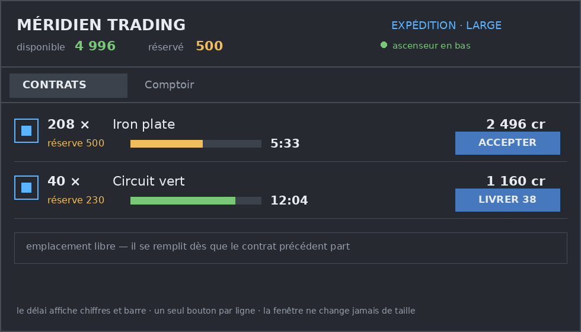

# 1. Le projet en une phrase

Un mod Factorio 2.1 : des **compagnies lointaines** postent des contrats depuis un comptoir spatial.
Les joueurs, réunis en coopérative, produisent, livrent et sont payés en crédits. Ces crédits achètent
des matériaux au même comptoir.

**La règle qui gouverne tout : le comptoir complète la production locale, il ne la remplace jamais.**
Aucun achat ne permet de sauter une technologie ni une chaîne de fabrication.

# 2. La boucle de jeu

1. Tu construis un **comptoir** — un ascenseur spatial avec son spatioport — tôt dans la partie,
   **avant le pétrole**.
2. La compagnie qui l'habite poste **un à trois contrats** : *un item, une quantité, un paiement, une
   échéance*.
3. Tu acceptes : **20 % du paiement est réservé** sur le pot commun.
4. Tu produis et tu apportes les marchandises dans l'inventaire du comptoir, à la main, par bras ou par
   robot.
5. Tu **envoies** : l'ascenseur doit être **en bas**. Les marchandises partent avec la cabine.
6. Au **retour** de la cabine, le paiement et la réserve sont crédités sur le pot.
7. Si l'échéance passe avant, la réserve est **encaissée par la compagnie**. Rien d'autre.

Un premier contrat ressemble à ceci :

```
208 plaques de fer · 2 496 crédits · 500 de réserve · 7 min 33
```

Les 7 min 33 sont 5 min 33 de production plus les 2 minutes de trajet de l'ascenseur.

# 3. Le périmètre de la v1

**Dedans.** Un seul mod. Un hub = une compagnie, avec son inventaire intégré. **Un seul type de
contrat.** Une boutique. Trois paliers. Espacement minimal entre comptoirs. Solo et multijoueur, avec et
sans le DLC Space Age. Interface en anglais et en français.

**Dehors, parqué avec son prix écrit.** La banque et ses intérêts, les primes de chasse, le droit
d'impression, les contrats récurrents et décroissants, la dette et la revente au-delà de la faillite, les
sites dédiés, l'achat de technologies, les transferts entre compagnies, l'énergie orbitale et la cabine
d'ascenseur réellement mobile.

**Trois principes non négociables.** Pas de monnaie physique : le crédit n'est qu'un nombre. Pas de
contrat nominatif : il appartient à la compagnie, n'importe qui peut le remplir. Et **une seule boucle** :
c'est ce qui a ramené huit nombres à équilibrer à trois.

# 4. Les règles, une par une

| Sujet | Règle |
|---|---|
| Construction | Technologie précoce, science rouge et verte. **Aucun ingrédient pétrolier.** Consommation électrique faible : le comptoir s'ancre à un réseau |
| Compagnie | Une par comptoir, créée à la pose. Nom, caractère, palier, compte. **Une compagnie n'appartient à aucun joueur** |
| Contrats | 1 à 3 actifs. Un emplacement libéré se **remplit immédiatement** |
| Acceptation | Réserve de 20 %, affichée avant le clic. Refusée si le solde libre ne couvre pas |
| Remplissage | Manuel, jamais automatique. Les marchandises doivent être physiquement dans le comptoir |
| Envoi | Manuel, contrat par contrat, **un seul vol à la fois**, et seulement cabine en bas |
| Paiement | Au retour de la cabine. Jamais deux fois |
| Expiration | La réserve part à la compagnie. Pas de dette, pas de réputation, pas de cascade |
| Boutique | Vend à **coût × 1,5**, achète **au coût**. Achète toujours, contrat ou pas |
| Économie par force | Chaque force a son pot, ses compagnies, ses contrats. Rien ne traverse |
| Interface | Une fenêtre, **deux onglets**, en-tête permanent `disponible · réservé` |
| Langues | Anglais et français, chaque chaîne dans les deux fichiers |

# 5. L'économie, chiffrée

La table de prix n'est pas une opinion : elle est **calculée depuis les recettes du jeu**, par un script
versionné qui lit les données de Factorio et remonte chaque chaîne jusqu'aux minerais.

| Article | Crédits | Article | Crédits |
|---|---|---|---|
| Câble de cuivre | 5 | Plastique | 228 |
| Plaque de fer / cuivre | 10 | Soufre | 334 |
| Tuyau | 10 | Circuit avancé | 525 |
| Brique de pierre | 20 | Batterie | 691 |
| Engrenage | 20 | Structure légère | 1 437 |
| Circuit électronique | 25 | Processeur | 1 717 |
| Plaque d'acier | 50 | | |
| Moteur | 90 | | |

**Trois nombres seulement sont choisis** : l'échelle (10 crédits par unité brute), la réserve (20 % du
paiement) et la dotation initiale (3 000 crédits, versés une fois à la coopérative). Tout le reste est
calculé.

**Une découverte a changé la conception :** la boutique devait acheter *au prix où elle vend*. C'est une
boucle d'argent infinie qu'un joueur trouve en une heure. Elle achète donc **au coût** : revendre est
toujours possible, jamais rentable. Un test le vérifie.

# 6. L'interface

Une fenêtre. Deux onglets : **Contrats** et **Comptoir**. Un en-tête qui ne bouge jamais : nom de la
compagnie, sa ligne de caractère, et deux nombres — `disponible · réservé`.

{width=16cm}

Choix arrêtés : **un seul bouton contextuel** par ligne (une erreur de clic coûte une réserve) · le délai
affiche **chiffres et barre**, et les chiffres ne changent jamais de couleur — le nombre informe, la
couleur alerte · les quantités sont un **champ avec quatre raccourcis** qui écrivent dedans · la fenêtre
**ne change jamais de taille**, pour qu'un contrat qui se termine ne déplace pas le bouton sous le curseur.

# 7. Ce qu'il faut savoir techniquement

- **Langage** : Lua 5.2, API Factorio 2.1. Aucun `on_tick` non borné — seul le compte à rebours de la fenêtre bat, et uniquement tant qu'elle est ouverte : tout passe par des événements, et les
  échéances sont évaluées à la lecture. Un comptoir inactif coûte zéro tick.
- **État** : une seule table `storage`, versionnée dès la première publication, avec une chaîne de
  migration.
- **Aléatoire** : un générateur propre au mod, une graine par compagnie. Jamais `math.random` — c'est la
  cause classique des désynchronisations en multijoueur.
- **Le hub est un conteneur** : les bras et les robots y insèrent nativement, sans script. Notre propre
  fenêtre se dessine par-dessus.
- **API publique** : une petite interface distante (`snapshot`, `act`, `api_version`), parce qu'un mod
  séparé ne peut pas lire le `storage` d'un autre — sans elle, aucun banc de test automatisé n'existe.

**Deux mesures ont corrigé des suppositions, le même jour :**

1. `game.write_file` **n'existe plus** en 2.1.23. Tout le banc de test reposait dessus. Remplacé par
   `helpers.write_file`, vérifié.
2. Les **packs de science ne disent pas la vérité** : les circuits avancés se débloquent avec de la
   science rouge et verte, mais exigent du plastique. Un palier copié sur l'arbre technologique aurait
   proposé des contrats impossibles. Les paliers se lisent donc sur la **profondeur dans la chaîne du
   pétrole** : 9 items au palier 1, 6 au palier 2, 1 au palier 3.

# 8. La qualité

**30 critères d'acceptation**, chacun avec sa preuve et son responsable : **17 prouvés en jeu**,
**6 statiquement**, **4 à l'œil**, **4 hors v1**.

Trois couches : statique (aucun lancement de jeu) · comportement headless · à l'œil. Le banc de test est un
**mod séparé**, jamais empaqueté. Et la commande d'acceptation **refuse d'être verte** tant que les quatre
critères visuels ne sont pas datés : un banc qui passe sur une fenêtre que personne n'a ouverte achète de
la fausse confiance.

# 9. Sécurité et droits

**Il n'existe aucun système de permission pour les mods.** Vérifié : 2.1.23 ne contient aucun type de
permission personnalisée, et un conteneur peut être miné par n'importe qui. Un rôle de « gérant » serait
une promesse que le moteur ne tient pas.

Donc **tout le monde peut agir**, et les dégâts sont bornés par les nombres : au pire 3 emplacements
bloqués, 20 % par échec, réserve affichée avant le clic, et une boutique qui achète toujours. Le pire
dégât est lent, visible et réparable.

**Aucune donnée personnelle** n'est stockée : pas de nom de joueur, pas d'identifiant, pas de temps de
jeu. Aucun code réseau, aucune télémétrie, aucun anti-triche — une sauvegarde est modifiable, prétendre le
contraire serait du théâtre.

# 10. Exploitation et publication

Rien à héberger, rien à superviser : les parties tournent chez les joueurs. Ce qui reste, c'est la
logistique de version.

- **Tester localement** ne demande aucun compte : le portail distribue, il ne filtre pas. On développe
  dans **deux dossiers de mods séparés** — avec et sans Space Age — jamais dans le dossier réel.
- **Publier** demande un compte factorio.com avec achat vérifié, une clé API, et une archive nommée
  `comptoir-contracts_<version>.zip`. Le mod apparaît en jeu **en cinq minutes environ**.
- **Version 0.x** jusqu'à ce que d'autres joueurs l'aient éprouvé et qu'il ait survécu à une montée de
  version du jeu. **Une publication ne se supprime ni ne se réécrit jamais** : une sauvegarde qui a
  installé `0.1.0` doit pouvoir retrouver `0.1.0`.
- **Support** : issues GitHub publiques, quatre champs demandés, et rien d'autre.

# 11. Le plan de création

Aucune date : l'ordre est un graphe de dépendances.

**Lot (a) — le cœur.** Prototypes, comptoir-conteneur, registre des comptes, génération des contrats,
réserve, machine à états de l'ascenseur, boutique. Jouable, testable entièrement en headless, sans
interface soignée. *Sortie : `make test` vert dans les deux configurations.*

**Lot (b) — l'interface.** Elle **s'ouvre par un spike d'une heure** sur la fenêtre personnalisée, parce
que c'est le seul choix de conception jamais mesuré. Puis : cadre, onglets, en-tête, lignes de contrat,
boutique, les quatre états dégradés. *Sortie : les 17 tests de jeu au vert et les quatre critères visuels
enregistrés.*

**Lot (c) — la finition.** Migrations, empaquetage, publication, CI limitée à ce qu'elle sait faire.
*Sortie : `make accept` vert avec le tableau visuel rempli, et la publication 0.1.0.*

# 12. Les risques

| Risque | Portée | Mitigation |
|---|---|---|
| Fenêtre personnalisée sur un conteneur, **jamais mesurée** | élevée | spike d'une heure en ouverture du lot (b), repli sur une fenêtre simple |
| **Désynchronisation** réseau réel | élevée | générateur local, aucun `math.random`, itération triée ; session à deux clients avant publication |
| Le rachat au coût peut **aplanir l'intérêt des contrats** | moyenne | la bande de paiement est le levier ; mesuré à la première heure de jeu |
| Le cycle de l'ascenseur peut ressembler à **une file d'attente** | moyenne | c'est un seul nombre ; l'échéance l'inclut, donc le raccourcir ne casse rien |
| Le **palier 3 ne contient qu'un item** | moyenne | les paliers sont dérivés : ajouter un item le reclasse tout seul |
| Une **migration de sauvegarde** qui se passe mal | élevée | version dès la première publication, migration par étape, test de chargement |

# 13. Où en est le cadrage

**Dix blocs sur dix, clos.** 76 décisions tracées, 44 ADR, 30 critères d'acceptation, 12 questions
ouvertes — **toutes rattachées à une fonctionnalité parquée**, aucune ne bloque la v1.

Chaque décision est un fichier dans `adr/`, numéroté, jamais réécrit : une décision change en étant
remplacée par la suivante, pas en effaçant la précédente. C'est ce qui permet de relire, dans six mois,
pourquoi le rachat se fait au coût et pas au prix de vente.

Le dépôt : `github.com/walbydev/comptoir-contracts`, public, licence MIT. Tag **`v0.1-cadrage`**.

**Aucune ligne de code de mod n'existe à ce jour.** La prochaine étape est le lot (a).
